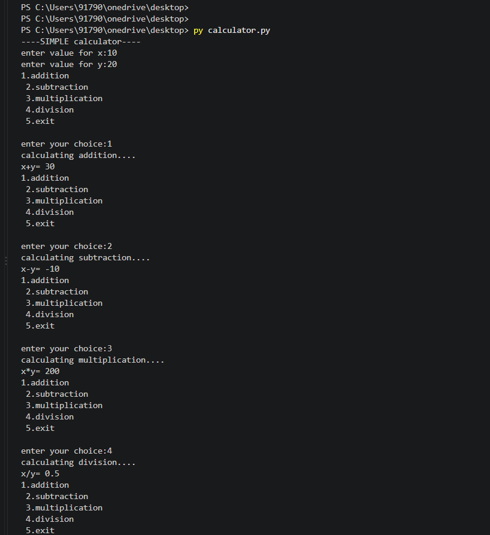
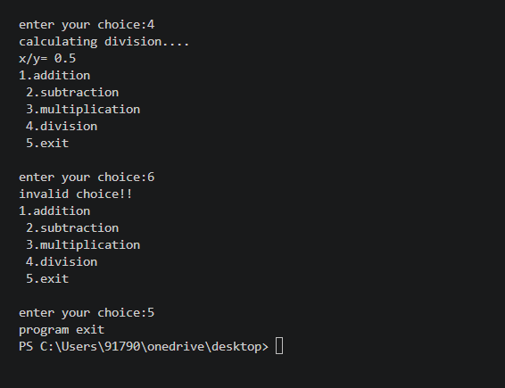

# Simple Calculator Using Python

A simple Python calculator that performs addition, subtraction, multiplication, and division using user input and a menu-driven program.

## Features
- Basic arithmetic operations
- Division by zero handling
- Invalid choice detection

## Language
Python

## Output

